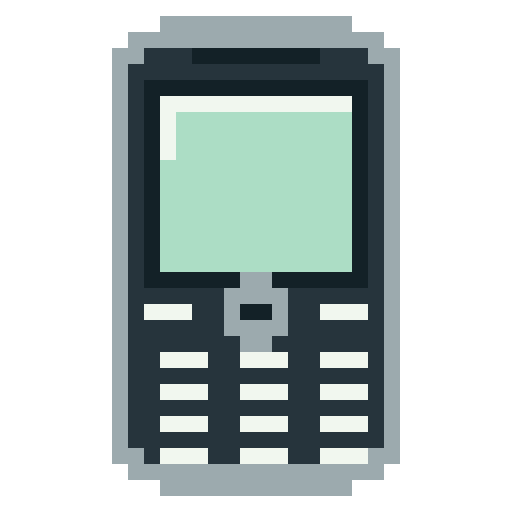

# Ph0nix



A native phone firmware emulator with a QEMU backend for the Sony Ericsson W800i and K750i. The K750i
R1DB001 CID49 profile boots into the original phone interface and reaches all
five Settings tabs and the bundled games through the native app backend. Native applications for
Linux, Windows and Android use a J2ME-Loader-based firmware library; see
[native applications and APK testing](docs/native-apps.md).

[Download Ph0nix 1.0 for Windows, Linux and Android](https://github.com/j92580498-max/Ph0nix/releases/tag/v1.0).
Firmware MAIN/FS images are imported by the user. See the
[1.0 release notes](docs/releases/1.0.md) for tested behavior and media limitations.

The Python research runner and browser tools remain available for DB2010
investigation. W800 R1L002 CID49 research images are supplied locally; their
identities are documented under `fw/`. [K750i bring-up](docs/k750i.md) records
its inputs and hardware limits.

## Hardware support

| Peripheral / part | MMIO range or interface | Status | Key facts |
| --- | --- | --- | --- |
| Boot ROM / bootloader | Hardware-reset mapping and handoff to MAIN unresolved | 🔴 | Original boot code unavailable; execution starts directly at MAIN's reset handler |
| NOR — Intel L18-compatible profile | `0x44000000–0x45FFFFFF` | 🟢 | 32 MiB; ID `89/880D`; read/program/erase; fitted part unverified |
| NAND — Samsung EC/35-compatible profile | Controller: `0x50000000–0x50000FFF` | 🟢 | 32 MiB plus spare data; logical storage range `0x50000000–0x51FFFFFF` is accessed through ports; no wear |
| DMA — PL080-style | `0xF2000000–0xF2000FFF` | 🟡 | Supported display and FA transfer paths |
| Timers, IRQ controller and RTC | Timers: `0xF9010000–0xF901001F`; IRQ banks: `0xFB020100–0xFB02039B`; RTC block: `0xF9050000–0xF905005F` | 🟡 | Selected registers, native interrupts and calendar; declared timing/reset assumptions |
| Missing ROM services — SHA/KGEN/ETX | Selected `0xFFFFxxxx` ROM call entries; **not MMIO** | 🟡 | Synthetic services; two GDFS digest read overlays; exact entries in usage guide |
| LCD — R61500 profile / RNH 942 29 module | PDI: `0xF7000100–0xF70001FF`; stream registers: `0xF7000300–0xF700030B` | 🟢 | 176×220 RGB565 through PDI/DMA; controller profile identified in firmware |
| Keypad, joystick and side keys | Matrix: `0xFB010000–0xFB010003`; selected GPIO registers in `0xF9000000–0xF900006D`; power contact at `0xF9050058` | 🟢 | Ideal contacts processed by firmware; physical shutdown absent |
| PMIC — Vincenne2 A07, ROP 101 3066/2 | I²C controller: `0xF9040000–0xF9040FFF`; 7-bit slave `0x4A` | 🟡 | Scoped transactions, register latches and synthetic inputs; analog behavior incomplete |
| UARTs / serial data | UART0: `0xFB060000–0xFB06002F`; UART1: `0xFC040000–0xFC04002D`; UART3: `0xFC030000–0xFC03002F`; UART4: `0xFB040000–0xFB04002D` | 🟢 | Four captures; UART0 file transfer or debug mode; selected registers only |
| SIM interface / synthetic card | `0xF9060000–0xF9060FFF` | 🟡 | Native byte/IRQ interface; accepted test SIM with ph0nix SPN/CPHS name; network registration absent |
| Bluetooth | Through UART3: `0xFC030000–0xFC03002F` | 🟡 | Initialization-failure peer; no functional Bluetooth service |
| FM radio | Through I²C at `0xF9040000–0xF9040FFF`; 7-bit slave `0x10` | 🟡 | Scoped write sink; no tuning or radio audio |
| Memory Stick | Selected registers in `0xFC010008–0xFC01002D`; GPIO42 detection | 🟡 | Empty-slot behavior; no card transfers |
| DSP / audio service peer — C55x candidate | Selected FA registers in `0xFA040000–0xFA0400BF` | 🟡 | No DSP instruction execution; host MP3/AAC-LC/AMR-NB services; EQ arithmetic absent |
| MIDI synthesizer — DSP service | Through the FA/DSP interface; no separate MMIO block | 🟡 | Host triangle synthesis: 40 voices, volume/expression, stereo pan, modulation, pitch bend, SP-MIDI allocation, pause/stop/loop and checkpoints; original instruments/banks absent |
| Camera | No identified camera device mapping | 🔴 | Focus/shutter contacts work; image capture absent |
| USB | Selected startup captures in `0xFD000004–0xFD0000FD` | 🔴 | No enumeration or packet transport |
| Cellular radio/network | No functional RF/network device mapping | 🔴 | No registration or calls |

## Setup

Requires Python 3.14+ with venv/pip support, available as `python3`.

On Linux (Debian/Ubuntu), install the build dependencies below. Install Python
3.14+ separately if needed:

```sh
sudo apt install git build-essential ninja-build pkg-config libglib2.0-dev \
  libpixman-1-dev zlib1g-dev libffi-dev
```

On macOS, use [Homebrew](https://brew.sh) and
[Python 3.14](https://formulae.brew.sh/formula/python@3.14):

```sh
xcode-select --install
brew install python@3.14 ninja pkgconf glib pixman
export PATH="$(brew --prefix python@3.14)/libexec/bin:$PATH"
```

Then clone, install and build on either platform:

```sh
git clone --recurse-submodules https://github.com/j92580498-max/Ph0nix.git
cd Ph0nix
python3 -m venv .venv && source .venv/bin/activate
python -m pip install -e '.[dev]'
python -m db2010.development.source init
python -m db2010.development.build --jobs 4
```

## Run

```sh
python -m db2010 --ui
```

Use `--help` for more options.

To prepare and run the K750i firmware:

```sh
python -m db2010.development.firmware init k750i
python -m db2010 --k750i --ui
```

MAIN/FS downloads are pinned to a public source commit. The GDFS backup comes
from firmware.center; all three inputs are checked against recorded hashes.
The current provisioned K750i profile reaches language selection, setup,
standby and Settings. Cellular service, Bluetooth connections, camera capture
and full hardware equivalence remain incomplete. `--k750i-prefix` retains the
earlier sparse bring-up profile.

See [advanced usage and troubleshooting](docs/usage.md) for controls, SSH,
diagnostics, traces, persistent state, GDB and testing, and
[firmware provenance](fw/README.md) for image identities and assumptions.

The DB2010 research runner and original board port derive from
[danylokos/db2010](https://github.com/danylokos/db2010). The native Samsung
research backend derives from
SamsungE380-Emu. Its required, licensed backend source is included under
[`dependencies/samsung-runtime`](dependencies/samsung-runtime).
Component licenses and interface attribution are retained in the source and
[third-party notices](frontends/android/THIRD_PARTY_NOTICES.md).
