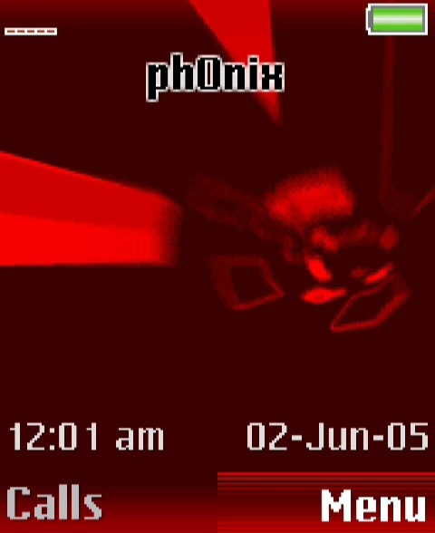

# Ph0nix

  

  A push-button phone firmware emulator for Linux, Windows and Android.

  
  

  <strong>Follow development updates on Telegram and join Discord for compatibility discussions, support and community chat.</strong>

---

> [!NOTE]
> Ph0nix is experimental. Compatibility, performance and hardware support vary
>

## Info

Ph0nix is a firmware emulator for Sony Ericsson DB2010 phones, focusing on the
K750i and W800i. It runs original phone firmware through a QEMU board model,
with native applications for Linux, Windows and Android.

## Sony Ericsson K750i interface

## K750i MIDI on Android

In **Settings → MIDI SoundFont**, choose your own `.sf2` file (up to 128 MiB). The app keeps a private copy and uses it the next time you open a K750i. Use **Restore default MIDI sound** to remove it. A regular APK does not bundle a SoundFont; without one, MIDI uses the built-in synthesizer. When resuming a saved session, a track that was already playing uses the built-in synthesizer until the next track starts.

## K750i Android build

In the original repository, assign the `ph0nix-owner` label to its Linux x64 self-hosted runner, then run **K750i cold boot and Android APK** on `main` from the Actions tab. The workflow runs the storage regression tests first, then builds and uploads `ph0nix-k750i-arm64.apk` with the standard application ID (`org.featurephone.emulator`). It does not publish a release. For in-place updates of existing K750i builds, the runner must already have the matching signing keystore in its Android user directory. The workflow verifies the signing certificate before building and before uploading the APK.

