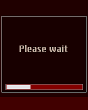
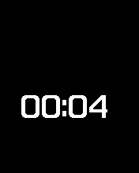

# K750i QEMU bring-up

K750i R1DB001 CID49 RED now reaches the original language selection, setup,
standby and all five Settings tabs on the ARM926 DB2010 QEMU board. The native
applications use the same backend through Rust and JNI; see
[native apps and APK testing](native-apps.md). Native preparation applies one
byte-checked Java compatibility instruction to its private MAIN mapping; the
user's original firmware files remain unchanged. Research preparation retains
the original instructions and copy guards.
Declared GDFS/NAND inputs, FS customization and synthetic hardware services
provide compatibility; cellular service, camera and Bluetooth connections
remain incomplete.

The latest native check starts from the app's cold-boot preparation, selects
English, skips and acknowledges setup, opens Settings, and switches General,
Sounds & alerts, Display, Calls and Connectivity. It also checks checkpoint
save/resume. The earlier startup captures below document the investigation
before the current customization and reset inputs were completed.




## Run

After the QEMU build and Python setup in the root README:

```sh
python -m db2010.development.firmware init k750i
python -m db2010.development.firmware check k750i
python -m db2010 --k750i --ui
```

These commands open the research browser view. `--ui 0` selects a free port.
For the native desktop application, run `cargo run -p featurephone-desktop
--bin ph0nix`; Android installation and Windows/Linux packaging
are described in the native application guide.

`init` downloads missing MAIN/FS containers and the GDFS backup. It verifies
complete file hashes, container record headers and sparse payload coverage,
and parses the logical GDFS units before publishing a download. Existing files
are checked without replacement. `check` works offline. Inputs live under
ignored `fw/k750i/` paths; generated storage and copy proofs use `build/inputs/`
and the selected run directory, with no dependency on investigation files.

For MAIN/FS files stored elsewhere:

```sh
python -m db2010 --k750i --ui \
  --main /path/to/K750_R1DB001_MAIN_EU_1_CL_RED49.mbn \
  --fs /path/to/K750_R1DB001_FS_EMEA_1_RED49.fbn
```

Both files must match the cataloged complete container and payload identities.
`--input-root /path` resolves all configured firmware paths under that root;
the firmware-fetch command accepts the same option. K750 profiles accept
MAIN/FS location overrides only.

## Saved screen evidence

The latest guarded browser run captures eight LCD updates. It reaches the logo,
then the “Please wait” screen, followed by progress-bar updates. The final panel
has all 38,720 pixels known, 38,396 nonblack pixels and nine colors. Its RGB565
bytes match the browser's binary display message exactly. The FM initialization
that previously stopped execution now completes through the existing shared sink
using the single observed K750 frame.

To reproduce the later screen and retain native execution guards:

```sh
python -m db2010 --k750i --research-guards --limit 320000000 --seconds 360 \
  --diagnostics --label k750-startup-ui
python -m db2010.diagnostics.verify artifacts/k750-startup-ui
python -m db2010.diagnostics.render_lcd_frames --run artifacts/k750-startup-ui \
  --output build/k750-startup-ui-frames
```

The checked browser run is `artifacts/k750-startup-ui-v3`; its 22 sealed artifacts
pass integrity verification. It stops at the requested 320 million observations,
46.786 guest seconds, after about 145 seconds of execution in this workspace.
The [later frame metadata](images/k750-please-wait.json) records source/build
identity, input identities, pixel hashes and the browser comparison. A bounded
stop establishes these screen milestones, not completed handset startup.

A longer run in default execution mode reaches the native clock screensaver and
its minute updates. At 303.283 guest seconds it has 14 LCD updates and no device
stop. Restoring that checkpoint and pressing/releasing the native Back contact
produces a fifteenth update, returning to “Please wait.” The
[clock metadata](images/k750-clock.json) identifies this separate run and records
that research guards were off.



The captured firmware trace retains `InitBook_Customization_Page` as the active
startup page. It also reports an OTP/GDFS mirror mismatch, static CRC failure,
radio activation failure with `RADIO_CONTROL_UED_ILLEGAL_DEVICE`, a DSP version
responder timeout and a failed hunt for the Program Manager. These observations
identify remaining startup dependencies; no one of them has been established
as the cause of the customization wait. The storage trace confirms that native
FS partitions mount, and later NOR activity continues. Investigation RAM dumps
and checkpoints are retained under `build/k750-main-screen/41-five-minute-startup/`;
the ordinary profile needs none of those files.

A bounded guarded run reaches the third LCD frame, containing the green orb
and Sony Ericsson text. The first two complete frames clear the panel to black.
The startup frame is 176×220 RGB565, with all 38,720 pixels known and 3,417
nonblack pixels. The firmware establishes its display controller, PDI packets
and DMA transfers; the host exports those resulting pixels.

To reproduce and retain the screen with native execution guards:

```sh
python -m db2010 --k750i --research-guards --limit 135000000 --seconds 75 \
  --diagnostics --label k750-startup-screen
python -m db2010.diagnostics.verify artifacts/k750-startup-screen
python -m db2010.diagnostics.render_lcd_frames --run artifacts/k750-startup-screen \
  --output build/k750-startup-frames
```

The run records effective configuration, input hashes, original RAM-copy proofs,
QEMU source/build identity, LCD frames and the final guest snapshot. The bounded
stop does not claim complete phone startup. Frame rendering needs no firmware
patch or test pattern.

The checked run is `artifacts/k750-startup-screen-v1`; its 21 sealed artifacts
pass integrity verification. The [frame metadata](images/k750-startup.json)
records QEMU revision, input identities and image hashes. In this workspace,
the guarded run reaches 135 million observations in about 42 seconds. Allow
enough boot time when using a wall-clock cap; the runner reports an exhausted
`--seconds` cap as a timeout and retains the stopped state.

## Authenticated inputs and storage assumptions

MAIN/FS come from
[hxbn-proto/se-resurrected at 7ef40799](https://github.com/hxbn-proto/se-resurrected/tree/7ef40799aad6dface08c756a5626dd52cdbdd8ce/k750i/firmware).
The user-supplied [firmware.center K750 archive](https://firmware.center/firmware/Sony-Ericsson/K750/)
also lists this revision and supplies the GDFS backup.

| Input | Bytes | SHA-256 |
| --- | ---: | --- |
| MAIN EU_1_CL RED49 | 18,534,368 | `048999c26718a39afb6bbce268b5bfee7cf70da679c8bd5010f1fd70f1eadbf2` |
| FS EMEA_1 RED49 | 10,498,016 | `c69102b6f6fedefeb70ca20c1572b506b7cc531790470a5dbd96503b1f417bf8` |
| K750_GDFS.bin | 53,827 | `e74786bc68180c2aa1efff127f2fd2a3e27925fc6397fbc2ca933ac8ee65c5b1` |

MAIN has 291 records in nine disjoint ranges; FS has 161 records in one range.
Preparation merges adjacent supplied records and preserves MAIN gaps. Opaque
container trailers are authenticated but are not mapped into flash.

The GDFS file is a logical backup, not a raw flash dump. Its 955 unit payloads
are preserved exactly. The host reconstructs seven 128 KiB active-bank headers
and reverse descriptors plus one erased spare bank, producing a 1 MiB image at
`0x45F00000` with SHA-256
`c863984315ebe22819fa7e546e73b204c2f9b4fcb5f4775f13aa0db46b978a00`.
Storage metadata is an explicit compatibility input.

The FS remainder `[0x45E00404, 0x45F00000)` is assumed erased FF, with synthetic
empty-block footers `5412` at `0x45E3FFFE`, `0x45E7FFFE`, `0x45EBFFFE` and
`0x45EFFFFE`. NAND page/spare data starts as assumed erased FF with good blocks.
The inherited NAND no-wear program/erase/copy protocols are synthetic. These
inputs do not overwrite authenticated MAIN/FS records.

The archive's customization ZIP was inspected separately. It is not applied by
this profile; the displayed startup image comes from the original firmware.

## Execution and hardware compatibility

The ARM reset vector at `0x44020000` selects `0x44020FB4`. The original-copy
execution contract covers these guest-written RAM regions:

| MAIN source | RAM destination | Bytes |
| --- | --- | ---: |
| `0x44022400` | `0x4C000000` | 36,008 |
| `0x4402B0B0` | `0x4C008CB0` | 4,880 |

The eight-byte gap at `0x4C008CA8` remains excluded. Proof files provide expected
bytes to the execution guard and never initialize RAM. Changed, unknown or
unapproved executable bytes stop guarded execution. External RAM zero fill and
the 28-byte cold DTCM reset record at `0x4200FFDC` are explicit assumptions.

The profile reuses shared W800 DB2010 controller, timer, RTC, LCD, PMIC and
transport models, adapted to observed K750 transactions. TIMER1/RTC run at
32768 Hz on QEMU virtual time. PMIC battery/ADC samples, clock/reset state,
NOR Intel `89/880D`, NAND Samsung `EC/35`, OTP identity and protection values
are compatibility inputs rather than measured K750 hardware values. The two
K750 PMIC calibration writes `0x88/0x89=0x15` are accepted.

Original MAIN `0x44EF74BC..0x44EF7900` establishes the hash FIFO register
sequence. The optional model implements immediate SHA-1 arithmetic, including
mode4/KGEN. KGEN cryptographic equivalence and physical timing remain
unestablished. Only identified K750 ROM SHA/KGEN initialization callers receive
synthetic context initialization; original MAIN runs the hardware update/final
routines. This profile uses no GDFS digest read overlays or ETX success service.

Original MAIN upload tables identify ten odd-length DSP tail pairs. Those pairs
start at assumed zero so the native final-halfword read/modify/write can preserve
the unused half. Guest uploads remain authoritative. DSP instruction execution
is not modeled. SIMIF setup register `0xF9060002` has the optional initial value0
for native read/modify/write setup; the GSM card is synthetic. Serial/Bluetooth
peers and shared keypad contacts are compatibility models. The shared FM I²C
write sink accepts the observed 11-byte startup frame `0080000bd20a0040100000`
at wire address `0x20`; radio tuning and RF behavior remain unmodeled.

GitHub code searches used the pinned
[R1DB001 reverse-engineering sources](https://github.com/hxbn-proto/se-resurrected/tree/7ef40799aad6dface08c756a5626dd52cdbdd8ce/k750i/re/decompiled)
and [SEW800iEmu](https://github.com/saup/SEW800iEmu/tree/9ac47db88357663b0fb89dc31251f2960bc91179/w800).
Original MAIN disassembly and guest accesses determine the implemented sequences.
Boot ROM/handoff, completed handset startup, cellular service, camera and physical audio
behavior remain incomplete.

## Sparse prefix

`--k750i-prefix` retains the earlier sparse boot resource with unknown FS/GDFS
tails, unseeded NAND reset/ID/status and no synthetic ROM hash services:

```sh
python -m db2010.development.firmware init k750i --prefix
python -m db2010 --k750i-prefix --research-guards --seconds 30
```

Its verified stop is `nor_read_unknown_array`, PC `0x0000CF8C`, address
`0x45E3FFFE`, after 16,697,595 observations and 113 timer IRQs. It has zero LCD
frames. The original firmware reads the final two bytes of a 256 KiB FS block
beyond the supplied FS end. This prefix remains available for investigations
that require missing storage to stay unknown.
